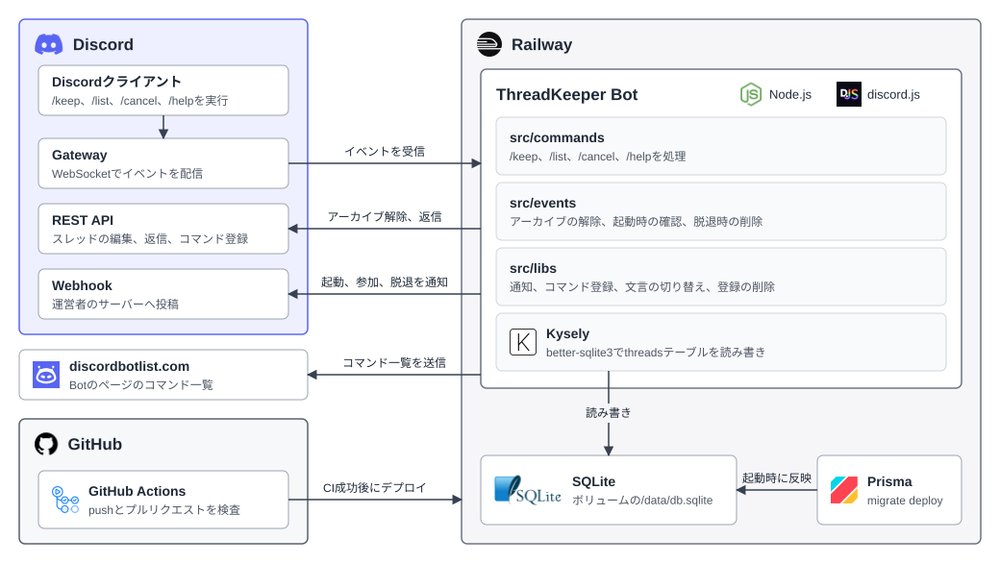

# 構成図

ThreadKeeperは、登録したDiscordのスレッドが自動でアーカイブされないよう見守るBotです。RailwayでNode.jsのプロセスとして動き、登録したスレッドをボリューム上のSQLiteに保存します。

## Discordとのやり取り

BotはGatewayにWebSocketで接続してイベントを受け取り、スレッドの編集や返信をREST APIへ送ります。購読するインテントは `Guilds` だけで、利用者が実行したスラッシュコマンドもGatewayから届きます。

`/keep` は実行したスレッドを `threads` テーブルに登録し、チャンネル一覧に残る期間（`auto_archive_duration`）を最長の7日に設定します。登録済みのスレッドがアーカイブされると、Botは `ThreadUpdate` イベントを受けて解除します。期間が7日以外に変更されたときは7日に戻し、そのスレッドに投稿して知らせます。モデレーターがロックしてアーカイブしたスレッドは、意図して閉じたものとみなして解除しません。

活動がないまま7日たつと、スレッドはアーカイブされなくてもチャンネル一覧から隠れ、このときイベントは届きません。そこでBotは、前回の再開から5日たったスレッドをクローズしてすぐ再開し、隠れる前に期間を更新します。ロック中のスレッドは対象にしません。

Botが止まっている間の変化はイベントで受け取ることができないので、起動時と毎日4時（日本時間）に、`src/events/keep-threads.ts` が登録済みのスレッドをまとめて確認します。起動時には、コードのコマンド定義とDiscordに登録済みの内容を比べ、違うときだけ登録し直します。

## データの保存

Botが読み書きするテーブルは `threads` だけで、サーバーとスレッドの組み合わせごとに1行を持ちます。`/keep` を実行した人の言語も保存し、スレッドに投稿するときに使います。Botがサーバーから外れると、そのサーバーの行を全て削除します。

実行時のクエリはKyselyとbetter-sqlite3で発行します。Prismaはスキーマの定義、マイグレーション、Kyselyの型の生成に使い、クエリには使いません。`npm start` は `prisma migrate deploy` でマイグレーションを反映してからBotを起動します。

本番環境では、Railwayのボリュームを `/data` にマウントし、`DATABASE_URL` を `file:/data/db.sqlite` にします。

## 外部への送信

Bot起動、サーバーへの参加、サーバーからの脱退は、`DISCORD_LOG_WEBHOOK_URL` のWebhookへ投稿します。運営者が導入状況を把握するための通知です。

起動するたびに、Discordに登録するものと同じコマンド一覧をdiscordbotlist.comへ送ります。送り先の認証には `DISCORDBOTLIST_TOKEN` を使います。

どちらの環境変数も任意で、設定しなければ送りません。送信に失敗してもログに残すだけで、Botは動き続けます。

## CIとデプロイ

GitHub Actionsの `CI` ワークフローは、`main` へのpushとプルリクエストで、型とLint、整形、マイグレーションの反映、テストを確認します。デプロイの手順はワークフローに含みません。

デプロイはRailwayが行います。RailwayのBotサービスはこのリポジトリの `main` ブランチと連携していて、pushを受けると自動でデプロイします。「Wait for CI」を有効にしているので、GitHub Actionsのワークフローが全て成功するまでデプロイは始まりません。プルリクエストではCIだけが動きます。

RailwayはRailpackでビルドし、`npm run start` で起動します。ボリュームを接続したサービスはレプリカを増やすことができないので、Botは1つのレプリカで動きます。
